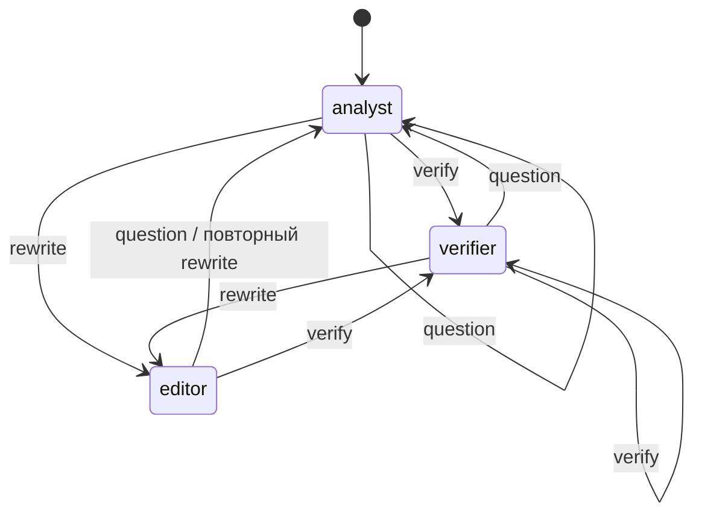

# Практика 3. Роли и конечный автомат

Путиенко Алексей Дмитриевич, БФБО-06-24.

Роли разделены по задачам:

- analyst находит и объясняет условия, температура 0,2;
- verifier сверяет процедуру с тарифом, температура 0,1;
- editor переписывает предыдущий ответ понятнее, температура 0,3.

Продукт в MVP один — обычный кредит наличными. Явный вопрос о кредитной карте,
ипотеке или другом банке получает отказ. При поиске обязательно используются
фильтры product=cash и допустимые source. У сверщика добавляется category,
если в вопросе распознана ровно одна рубрика. Затем отдельным MCP-запросом
получается короткий тариф целиком: рубрика одного фрагмента не всегда описывает
все его условия. Источники объединяются без дублей, контекст ограничен десятью частями.

Неоднозначная фраза «заплачу больше» расширяется поисковыми словами о частичном
досрочном погашении. Это уточнение темы запроса, в него не зашиваются значения
ставок и сроков. Редактор сохраняет предыдущий найденный контекст: повторный поиск
по слову «проще» давал нерелевантные фрагменты и был убран для этой роли.

| Фраза | Интент | Роль |
|---|---|---|
| Как считается ПСК кредита наличными? | question | analyst |
| Какие сроки у кредита наличными? | question | analyst |
| Проверь размер штрафа | verify | verifier |
| Можно ли погасить досрочно? | verify | verifier |
| Что будет при просрочке? | verify | verifier |
| Если я заплачу больше, пересчитают? | verify | verifier |
| Объясни простыми словами | rewrite | editor |
| Напиши короче | rewrite | editor |
| Здравствуйте! | question | analyst |
| Абвгд | question | analyst |

Переход editor → editor запрещён: после повторной просьбы сначала возвращаемся
к аналитику для сверки фактов. Откат виден в логе и проверен тестом. Неизвестный
интент уходит к аналитику. Граф задан словарём множеств, модель для выбора роли
не вызывается. При смене роли найденные фрагменты переносятся и убираются дубли.

Поиск идёт через MCPTools, прямого вызова mcp_server.search из ядра нет.
Сам автомат проверяется отдельно от модели. Сквозная генерация и память относятся
к следующим практикам. Сигнатура Orchestrator.handle(session_id, text) сохранена.
